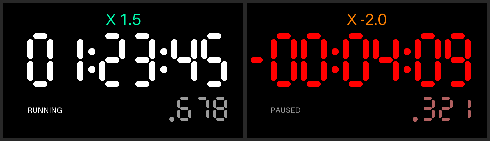

# Timebank prototype 2: ideaspark ESP32 1.14"

Second Timebank prototype, on the ideaspark ESP32 dev board with a 1.14" 135×240 ST7789 LCD,
CH340 USB, WiFi/BT and a LiPo battery connector. The first prototype (Waveshare ESP32-S3 3.49",
repo root) stays as it was.

## What it does

A stopwatch whose time can run faster, slower or backwards:
`X 3.0, X 2.0, X 1.5, X 1.0, X -1.0, X -1.5, X -2.0, X -3.0`.
Time can go below zero; the digits then turn red with a minus sign.

Same look as prototype 1, scaled to the small screen: black background, white seven-segment
HH:MM:SS, small grey milliseconds, speed label on top coloured red→yellow (backwards) and
green→blue (forwards), RUNNING/PAUSED underneath.

## Controls (BOOT button)

| Action | Result |
| --- | --- |
| Click | Pause / resume |
| Double click | Next speed on the same side (1.0 → 1.5 → 2.0 → 3.0) |
| Hold ~1 s, release | Flip direction (jump to X 1.0 or X -1.0) |
| Hold 5 s | Reset to 00:00:00.000 and X 1.0 |

While holding, the bottom line shows what releasing will do and a red bar fills towards reset.
Time and speed are saved to flash on every change and every 10 s while running; after power-off
the timer comes back paused at the saved value.

## Building

- Arduino IDE board: **ESP32 Dev Module** (esp32 core 3.x).
- Libraries: **Adafruit ST7735 and ST7789 Library**, **Adafruit GFX Library** (installs **Adafruit BusIO**).
- Open `timebank_ideaspark/timebank_ideaspark.ino` and upload.

Display pins are set at the top of the sketch (MOSI 23, SCLK 18, CS 15, DC 2, RST 4, backlight 32).
These are the commonly published pins for this board; if the screen stays black, check them against
your board's silkscreen or seller page.
